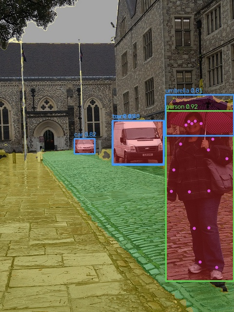
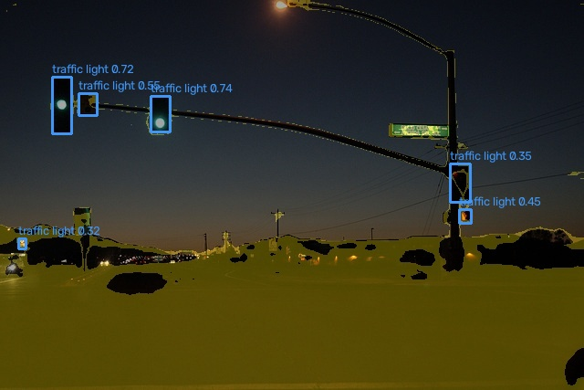
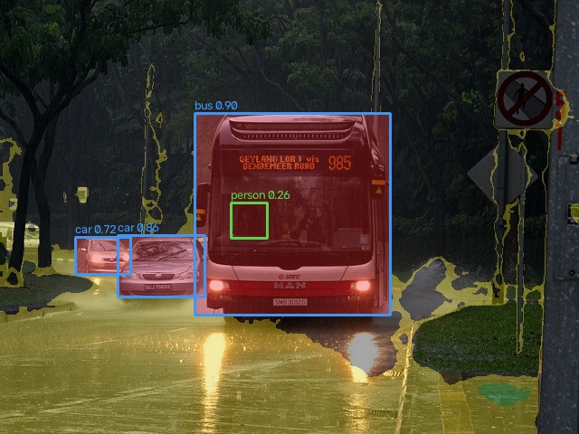

# AI Vision — 100 Images. One AI.

**Object detection · Tracking · OCR · Pose · Relative depth · Open source**

| Real street perception | Night scene | Rainy scene |
|---|---|---|
|  |  |  |

**Videos:** [Watch the 30-second TikTok with music](https://www.tiktok.com/@e.nsan/video/7694919798202928391) · [Original 50-second film](https://github.com/qentrah/ai-vision-engine/releases/download/v0.1.0/detections-100-images.mp4) · [30-second vertical download (silent)](https://github.com/qentrah/ai-vision-engine/releases/download/v0.1.0/ai-vision-tiktok-30s-silent.mp4)

**Topics:** `computer-vision` `yolo26` `object-detection` `object-tracking` `ocr` `python` `pytorch` `open-source`

A local Python perception engine for images, directories, video, and optional cameras. The first release includes **100 licensed internet images**, actual YOLO26 predictions, a fine-tuning experiment, controlled degradation tests, structured JSON, and a **50-second animated results film**.

The source is AGPL-3.0. Images and optional model weights retain their own licenses. No camera was accessed while building the release.

## Install

Python 3.11 or 3.12 and [uv](https://docs.astral.sh/uv/) are required. Install FFmpeg for film export.

```bash
git clone https://github.com/Up-to-code/ai-vision-engine.git
cd ai-vision-engine
uv sync --extra dev
uv run ai-vision image path/to/image.jpg
```

Official detector weights download automatically on first use. Models are cached locally and excluded from Git. After weights are cached, inference can run offline. Keep the same working directory when using relative model paths. Optional models have separate caches; setting `HF_HOME` before the first run changes the Transformers cache.

```bash
uv sync --extra dev --extra ocr --extra scene --extra face
uv run ai-vision --ocr --pose --face --depth --segmentation image path/to/street.jpg
uv run ai-vision --ocr --ocr-languages ar en image path/to/arabic-sign.jpg
uv run ai-vision --config configs/default.yaml image path/to/street.jpg
```

Flags precede the command. Enabled optional components initialize once per engine. Errors propagate with a traceback; requested failures are not concealed as empty predictions.

## Images, video, and cameras

```bash
uv run ai-vision benchmark --source path/to/jpeg-directory --output outputs/my-images
uv run ai-vision video path/to/video.mp4 --output outputs/video
uv run ai-vision camera --device 0 --display
uv run ai-vision --compute cpu camera --device 1 --display --max-frames 300
```

Video outputs contain a tracked MP4 and frame-by-frame JSONL. Camera access is explicitly initiated by the camera command. `--display` opens the OpenCV preview; Q exits. Without it, capture is headless. Set `--max-frames` to bound recording. ByteTrack assigns temporary stream-local IDs; motion history estimates speed in pixels/second from consecutive frames. Newly/no-longer visible events are observations, not proof of physical entry/exit. Camera movement and ID switches affect these estimates. Independent images never share tracking IDs.

Device selection prefers CUDA, then Apple MPS, then CPU. `--compute cpu` overrides it. YOLO MPS unsupported-operator errors retry on CPU with a warning. Optional OCR and Transformers modules deliberately run on CPU for compatibility.

## Reproduce the 100-image experiment

```bash
uv run ai-vision collect --count 100 --seed 20261010
uv run ai-vision benchmark --degrade --output outputs/pretrained
uv run ai-vision validate --output runs/pretrained
uv run ai-vision train --epochs 3 --output runs/finetune
uv run ai-vision --model runs/finetune/run/weights/best.pt validate --output runs/finetuned-validation
uv run ai-vision --ocr --pose --face --depth --segmentation benchmark --output outputs/full-perception
uv run ai-vision film --source outputs/full-perception --seconds 50 --output outputs/detections.mp4
```

Collection downloads COCO's annotation archive (about 242 MiB), then 100 individual images rather than the entire image dataset. It randomly samples images with vehicle, bicycle, traffic-light, or stop-sign annotations and CC BY, CC BY-SA, or government-work metadata. This filter creates diverse street-context examples but also some indoor/transport contexts; it does not guarantee all images are streets. The originals remain unchanged. Each manifest entry records original Flickr URL, download URL, source license, resolution, timestamp, and SHA256. Respect attribution and share-alike terms for image derivatives. `ATTRIBUTION.md` provides per-image source links and credit identifiers from COCO metadata.

Real COCO annotations are converted to YOLO labels, excluding crowd regions. The seeded order assigns 80 training and 20 validation images. The short run freezes the first 10 layers, uses AdamW, and retains the best validation checkpoint. This is fine-tuning a pretrained model, not training from scratch. **The pretrained baseline performed better, so it remains the default and powers the film.** The fine-tuned checkpoint is included as an experiment in the release.

COCO validation data contributed to development of the upstream pretrained model. The holdout is separate from this fine-tuning run, but it is not an independent generalization benchmark. Only detection has labeled ground truth; OCR, pose, face, depth, and segmentation outputs are qualitative. Confidence is not accuracy.

## Available perception

| Component | Backend | Output and limits |
|---|---|---|
| Objects/people | YOLO26 Nano, COCO 80 classes | Boxes, classes, confidence, centers; class support does not include arbitrary signs/roads |
| Tracking | ByteTrack | Stream-local IDs and temporal image-plane motion; no tracking across unrelated photos |
| OCR | EasyOCR | Text polygons and confidence, English and configurable Arabic; low-score text filtered, empty results do not prove no text |
| Pose/activity | YOLO26 Nano Pose | 17 keypoints; conservative static arm-raised geometry; walking/running/waving remain unknown |
| Faces | MediaPipe Face Landmarker | Observable blendshapes and tentative smiling-looking result for sufficiently large faces; no identity or inner-emotion inference |
| Depth | Depth Anything V2 Small | Relative heatmap; no metric distance |
| Walkable candidates | SegFormer B0 / Cityscapes | Sidewalk mask with confidence threshold, uncertain road regions, detected-object boxes marked as obstructions; experimental, not navigation certification |

Face outputs are independent of person boxes and are not identity-linked. Small/occluded faces often produce no landmarks or unknown expression. No general-purpose temporal action classifier or SLAM trajectory estimator is implemented. Segmentation does not fuse depth into a calibrated traversability model; never drive a physical robot solely from these outputs. The default detector is optimized for speed; the full CPU pipeline is substantially slower.

## Python API

```python
from ai_vision import VisionConfig, VisionEngine

vision = VisionEngine(VisionConfig(ocr=True, pose=True))
result = vision.analyze_image("street.jpg")
print(result.model_dump_json(indent=2))
# For a real video stream: BGR uint8 frame, monotonic media timestamp in seconds.
result = vision.analyze_frame(frame, timestamp_seconds=1.2, frame_id=36)
vision.reset_tracking()  # before switching to another stream
```

The API accepts filenames or BGR NumPy arrays. Pydantic models validate serialized results. Unknown scene fields are null when segmentation is disabled; static movement is null. Heatmaps live in `vision.artifacts` and the result records the model identifiers and enabled/disabled modules.

Each analyzed image gets original, object, OCR, pose, combined JPEGs and JSON; enabled depth and segmentation add separate images. Missing module images are deliberately absent when disabled. OCR/pose-only views can equal the original when no prediction is available. The film animates the independent photographs and reveals model overlays; its zoom is presentation motion, not inferred scene motion.

## Tests and optimization

```bash
uv run pytest -m 'not integration'
uv run ai-vision collect
uv run pytest -m integration
uv run ruff check src tests
uv run ruff format --check src tests
uv sync --extra export
uv run ai-vision export --format onnx
```

Tests cover schema validation, empty detections, corrupted/missing input, module errors, immutable degradation inputs, camera release with mocks, temporal tracking, and real inference. See `reports/RESULTS.md` for executed tests and measured results. ONNX is exportable; Core ML export is exposed but requires its platform dependencies. FP16/INT8 are not enabled without measured validation. No unverified acceleration claims are made.

## Model and data licensing

- [Ultralytics YOLO26](https://docs.ultralytics.com/models/yolo26/) and its code: AGPL-3.0 or commercial Enterprise license. This repository uses AGPL-3.0.
- [COCO](https://cocodataset.org/#termsofuse): annotations CC BY 4.0; each photograph keeps its original license. The collected manifest restricts eligible licenses and supplies attribution.
- [EasyOCR](https://github.com/JaidedAI/EasyOCR): Apache-2.0 code; downloaded recognition/detection models retain upstream terms.
- [MediaPipe](https://developers.google.com/edge/mediapipe/solutions/vision/face_landmarker/python): Apache-2.0 project; model asset terms remain upstream.
- [Depth Anything V2 Small](https://huggingface.co/depth-anything/Depth-Anything-V2-Small-hf): Apache-2.0 model card.
- [SegFormer Cityscapes](https://huggingface.co/nvidia/segformer-b0-finetuned-cityscapes-1024-1024): NVIDIA model-card license terms (including its stated non-commercial restrictions) apply to this optional model. It is not relicensed by this repository's AGPL license. Disable it for uses inconsistent with those terms.

Release archives preserve image credits and source-license metadata. Models and images are not committed to source Git. There are no cloud inference calls, secrets, or camera recordings in the release.

## First release downloads

[Download the film, 100-image dataset, analysis archives, and experimental checkpoint](https://github.com/qentrah/ai-vision-engine/releases/tag/v0.1.0).


Photo attribution and original license: see [ATTRIBUTION.md](ATTRIBUTION.md), image `000000313588.jpg`. The displayed model overlay is a derived visualization.

## TikTok edition

[**Watch the published TikTok — 30-second AI Vision cut**](https://www.tiktok.com/@e.nsan/video/7694919798202928391)

Suggested title: **100 Images. One AI. — AI Vision**

The original 50-second landscape film is preserved. The separate TikTok cut is exactly 30 seconds, 720×1280 (9:16), with all 100 images sped up to 0.3 seconds each. Full-frame blurred image backgrounds replace the old black margins, while the complete foreground image and model overlays remain visible. This is presentation editing, not faster model inference.

Suggested caption and hashtags:

> 100 images. One AI. 👁️ Built a local vision engine with YOLO26, object tracking, OCR, pose and depth. Tested 100 licensed internet images + 600 blur/noise variants. No camera used. Code & results: https://github.com/qentrah/ai-vision-engine — AGPL-3.0 code; images/models keep their own licenses. #AIVision #ComputerVision #YOLO #Python #OpenSource #BuildInPublic

Music for the TikTok post: **Stayin Alive — Bee Gees**, selected as a 30-second sound in TikTok's native editor to match the reference's disco feel. The embedded alternate soundtrack was muted before saving the TikTok edit. The reference uses a Stayin' Alive sound credited to konsalyrics. A separate local alternate edit uses **Funky Disco Groove — Gizmo Gadget Guy** from TikTok Studio's royalty-free sound library. The GitHub vertical download is silent; TikTok music is not included or relicensed as project code.

Recreate the silent portrait cut from an extracted analysis archive:

```bash
uv run python -m ai_vision.social_video --source outputs/full-perception --output outputs/ai-vision-tiktok-30s.mp4
```

## Project links

[Source](https://github.com/qentrah/ai-vision-engine) · [Issues](https://github.com/qentrah/ai-vision-engine/issues) · [Public project directory](https://github.com/qentrah/.github/blob/main/profile/PROJECTS.md)
